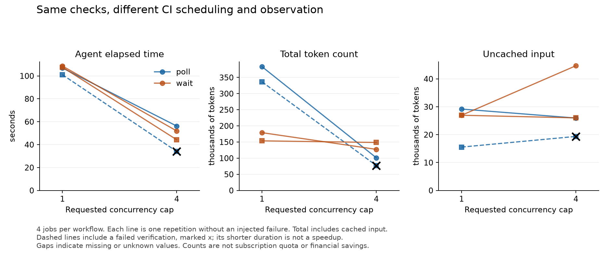

# Pilot results

On 12 October 2026, twelve planned trials produced eleven complete verifications. One trial stopped after a dispatch command returned an error even though GitHub had created the workflow. The harness cancelled that run; its usage remains in every applicable aggregate. All dispatched workflows were later confirmed terminal.

Parallel CI shortened elapsed time in every pair where both conditions completed verification. Token outcomes varied. In the first complete no-fault polling pair, total tokens fell from 383,550 to 101,314. In the polling pair with a retry, they rose from 236,116 to 353,069. The tool-wait retry pair used 128,201 and 127,844 tokens despite elapsed time falling from 153.1 to 83.4 seconds. These are individual observations, not estimates of a typical saving.

- [Full numeric report](pilot-summary.md), with every trial, paired differences, and input/output/cache accounting.
- [Machine-readable trial records](pilot.jsonl) and [the planned order](pilot.plan.json).
- [Three preflight attempts](PREFLIGHT.md), retained separately with their usage and protocol problems.
- [Final workflow state verification](workflow-verification.json), including the cancelled run.

## Experiment settings

| Setting | Value |
| --- | --- |
| Workflow and harness source | [490bddcf9a6b4c8abe113d8fd4e35b2f84ecbc7f](https://github.com/dnikolayev/ci-cd-tokens-test/tree/490bddcf9a6b4c8abe113d8fd4e35b2f84ecbc7f) |
| Model | gpt-6-astra |
| Reasoning setting | max |
| CLI version | codex-cli 0.162.1 |
| Runner label | ubuntu-latest |
| Jobs per first attempt | 4 |
| Hold per job | 15 seconds |
| Observer polling interval | 10 seconds |
| CI observation limit | 600 seconds |
| Outer agent allowance | 780 seconds |
| Repetitions | 2 per stable condition; 1 per injected-failure condition |
| Random seed | 20261012 |
| Existing user configuration | Loaded; fixed across conditions, contents private |

The command was:

```sh
python3 benchmark.py pilot --repo dnikolayev/ci-cd-tokens-test \
  --model gpt-6-astra --reasoning max --use-user-config
```

The same checks and hold duration applied to every condition. Successful serial runs reached an observed peak of one job; successful parallel runs reached four. A partial rerun carried the three previously successful job results forward. Those repeated API entries were excluded from job-time and overlap totals.

## Stable trials



Each line is one repetition without a deliberately injected failure. A dispatch error occurred in one of these trials. The dashed line preserves that pair, and the cross marks its failed verification; its shorter duration cannot be treated as faster completed work.

## What the data supports

This pilot shows how to measure the comparison and why elapsed time, repeated observation, and token accounting should be kept separate. It does not establish a reliable token-saving percentage, a subscription-allowance reduction, or the effect of buying more hardware. The treatment changed a workflow admission cap.

The waiting control still used a shell interface that can yield and require another model interaction. Completed command items do not count those waits or every model request. CLI context, available tools, caching, agent decisions, and hosted-runner scheduling can affect the observations. Existing user configuration was loaded for a required host sandbox setting; its private contents are not published. Reproduction runs the same comparison, with token counts that can vary across installations and runs.

All twelve planned trials are retained. Per-success usage includes the failed trial's tokens in the relevant numerator. CI completion duration is unknown for that failed trial, rather than zero. The three preflight trials used earlier protocol revisions and are reported separately; their 230,724 total tokens are not silently discarded or mixed into treatment comparisons. None of these counts includes the effort of developing the benchmark.
