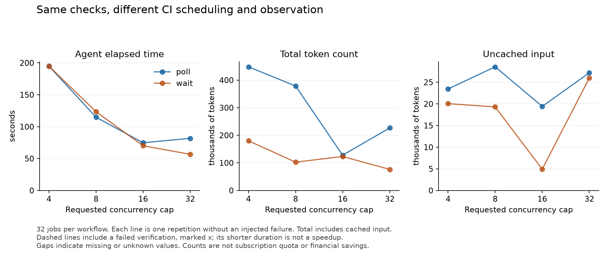

# Scaling from 4 to 32 concurrent jobs

On 12 October 2026, all eight planned trials completed verification. Every workflow contained the same 32 jobs, each running the unchanged assertions and a 15-second hold. The requested caps were 4, 8, 16, and 32.

There is one trial per cap and monitoring approach. These are exploratory observations, not estimates of an optimal setting. This is a separate workload from the original four-job pilot.

| Monitor | Cap | Observed peak | CI seconds | Agent seconds | Total tokens | Uncached input |
| --- | --- | --- | --- | --- | --- | --- |
| poll | 4 | 4 | 183.4 | 194.9 | 448,226 | 23,454 |
| poll | 8 | 8 | 106.1 | 114.8 | 378,660 | 28,570 |
| poll | 16 | 16 | 57.6 | 74.7 | 127,924 | 19,427 |
| poll | 32 | 32 | 57.9 | 81.7 | 226,808 | 27,185 |
| wait | 4 | 4 | 182.2 | 194.8 | 179,956 | 20,054 |
| wait | 8 | 8 | 98.4 | 123.4 | 102,658 | 19,310 |
| wait | 16 | 16 | 56.6 | 70.1 | 123,233 | 4,922 |
| wait | 32 | 32 | 35.6 | 56.7 | 76,358 | 25,982 |

Agent time includes startup and the final response. CI time includes dispatch, queueing, and detection delay. Total tokens are input plus output, including cached input. They are not allowance percentages or financial costs.

All requested caps were reached in these trials. Peak overlap describes a moment in the run, not sustained concurrency or simultaneous startup. The raw job timestamps retain the timing detail.

Moving from cap 4 to cap 16 shortened both observed session times. Cap 32 improved the tool-wait trial further, while the polling trial was slightly slower than at 16. One trial per condition cannot establish an optimal cap.

From cap 4 to cap 32, total tokens decreased in both monitoring approaches, while uncached input increased in both. This is why the retained records distinguish cached input, uncached input, and output, and do not convert total tokens into subscription savings.



## Reproduce

Source revision: [e0d18aab3cc78cc9df633fd468c1b0c5d2d5ad2a](https://github.com/dnikolayev/ci-cd-tokens-test/tree/e0d18aab3cc78cc9df633fd468c1b0c5d2d5ad2a). Settings: gpt-6-astra, max reasoning, codex-cli 0.162.1, 15-second hold, 10-second polling, 600-second observation bound, seed 20261012, existing user configuration loaded. Configuration contents remain private. Use the same source, model settings, and host configuration within a comparison.

```sh
python3 benchmark.py pilot --repo YOUR_USER/ci-cd-tokens-test \
  --model YOUR_MODEL --reasoning YOUR_REASONING_SETTING \
  --jobs 32 --caps 4 8 16 32 --repeats 1 --fault-repeats 0 \
  --output .runs/scaling.jsonl
```

The recorded run also used `--use-user-config`, as explained in the [reproduction instructions](../README.md#reproduce). GitHub account limits can prevent a cap of 32 from being reached. More repetitions are needed to assess variability. Hosted runner startup and scheduling, prompt caching, and agent decisions can change the results.

- [Full numeric report](scaling-summary.md), including baseline comparisons and separate token counters.
- [All eight trial records](scaling.jsonl) and [the planned order](scaling.plan.json).
- [Verified terminal workflow states](scaling-workflow-verification.json).
- [Original four-job pilot and preflight attempts](README.md).
